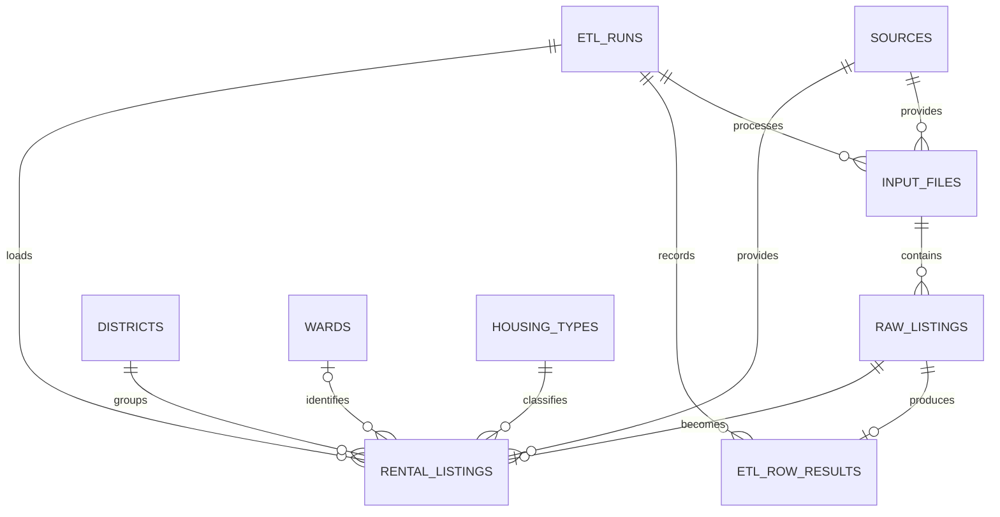

# Thiết kế PostgreSQL cho ETL và dashboard

## Mô hình và độ chi tiết

Schema `rentals` gồm chín bảng. Một tin sạch là một tin đăng trong một lần xử lý thành công; khóa duy nhất là `(run_id, source_id, source_listing_id)`. Tin không được coi là một bất động sản độc lập đã xác minh. Bảng vật lý lưu lịch sử nhiều lần chạy; view dashboard chỉ trả lần thành công mới nhất.

| Bảng | Khóa chính | Nội dung |
|---|---|---|
| `sources` | `source_id` | Tên và URL hai nguồn |
| `etl_runs` | `run_id` | Thời gian, trạng thái, checksum đầu vào/quy tắc, kết quả và lỗi |
| `input_files` | `file_id` | File raw của mỗi nguồn trong từng lần chạy |
| `raw_listings` | `raw_id` | Số dòng, mã tin và toàn bộ dữ liệu raw dạng JSONB |
| `etl_row_results` | `run_id, raw_id` | Giữ/loại, bước, lý do và cờ chất lượng |
| `districts` | `district_id` | Quận/huyện lịch sử đã chuẩn hóa |
| `wards` | `ward_id` | Phường/xã mới có đủ căn cứ |
| `housing_types` | `housing_type_id` | Phòng trọ, căn hộ, nhà nguyên căn, biệt thự |
| `rental_listings` | `listing_id` | Các trường phân tích có kiểu dữ liệu và khóa ngoại |

Không ép phường mới thuộc duy nhất một quận cũ. `ward_id` được phép NULL; dữ liệu thời gian gốc được giữ trong JSONB và metadata của file, không suy ngày đăng từ thời gian ETL.

## Thuộc tính tin sạch

Mã tin là TEXT. Giá thuê đồng/tháng và giá/m² làm tròn là BIGINT; diện tích là DOUBLE PRECISION. Giá giới hạn 0,5–500 triệu đồng/tháng và diện tích 5–1.000 m² hoặc NULL. Đơn giá phải khớp giá chia diện tích trong sai số làm tròn tối đa 1 đồng/m²; thiếu một đầu vào thì đơn giá NULL. Liên kết bắt buộc có dạng HTTP(S); nguồn/mã tin và nguồn gốc raw được kiểm tra qua khóa.

## View

- `v_current_run`: lần ETL thành công đang vận hành.
- `v_all_listings`: dữ liệu các lần chạy với số run, thứ tự và 15 cột tiếng Việt.
- `v_dashboard_listings`: 15 cột của lần đang vận hành, tương thích cấu trúc `combined.csv`.
- `v_notebook_listings`: tập có diện tích, vẫn giữ giá thiếu.
- `v_etl_summary`: số dòng raw, sau clean, nạp và loại theo nguồn/lần chạy.
- `v_lineage`: truy ngược tin và quyết định xử lý tới tên file, số dòng và dữ liệu gốc.
- `v_data_quality_summary`: số thiếu giá, diện tích, đơn giá, phường và số tin đủ trường.
- `v_district_type_medians`: số tin và trung vị giá theo khu vực/loại chỗ ở.

## Quy tắc và trạng thái

`etl_row_results.reason_code` dùng các giá trị: `outside_time_label`, `outside_hanoi`, `sale`, `business_only`, `duplicate_source_id`, `per_person_or_bed`, `hanoi_unconfirmed`, `unresolved_housing_or_purpose`, `accepted`. Trạng thái giá/diện tích/phường nằm trong `quality` và các cột tin sạch.

Việc một dòng bị loại có một lý do chính để đếm không chồng lấn. Một tin được giữ có thể đồng thời thiếu giá hoặc thiếu phường; không xóa tin chỉ do thiếu các thuộc tính đó. Tất cả 7.791 dòng raw của một lần thành công phải có kết quả; số nạp cộng số loại bằng số raw.

CSV đầu ra là sản phẩm đối chiếu được xuất sau khi nạp DB thành công. Nếu bước xuất CSV bị lỗi quyền ghi, DB đã commit vẫn là nguồn dữ liệu đang vận hành; chạy lại cùng raw/quy tắc sẽ xuất lại CSV mà không nhân đôi tin.
